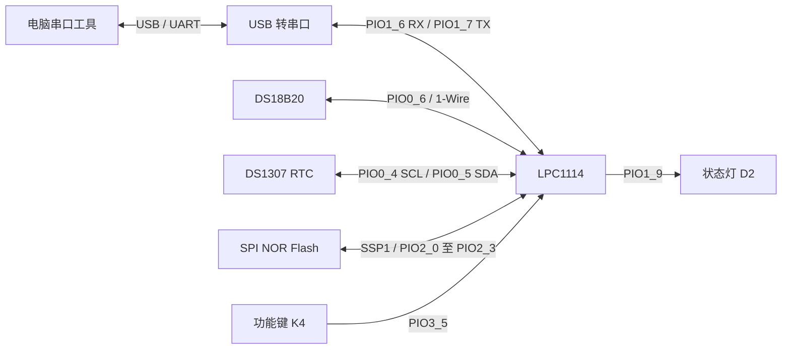
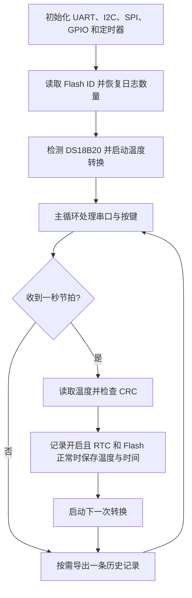

# 系统连接与软件流程

开发板实物连接以 [LPC1114 DevKit V5.6 原理图](hardware/LPC1114-DevKit_V5.6.pdf) 和实际元件为准。下面是依据当前固件绘制的功能示意，省略了电源、滤波、复位和下载电路，不能作为完整电气原理图。

图纸中 U7 的 DQ 连接 PIO0_6，R22 为 4.7 kΩ 上拉。传感器 VDD、GND 及系统电平应按原理图和实际供电核对。RTC 断电走时依赖后备电池；主电源关闭期间设备不会继续采集温度。

## 运行流程

一秒定时器中断负责检查并清除匹配中断标志、设置 `tick` 和更新秒计数；温度读取、时钟访问和 Flash 写入由主循环执行。上述流程是功能概览，错误分支和暂停状态以 `Blinky.c` 为准。

[查看项目提供的流程图原图](hardware/provided-flowchart.png)。该图为概念示意，其中定时器中断的标志处理顺序与代码不完全一致：代码先检查匹配标志，再清除标志并设置 `tick`；计数器复位由定时器匹配控制配置执行。

## 引脚分配

| 连接 | 引脚 |
| --- | --- |
| DS18B20 DQ | PIO0_6 |
| DS1307 SCL / SDA | PIO0_4 / PIO0_5 |
| UART RXD / TXD | PIO1_6 / PIO1_7 |
| SSP1 CS / SCK / MISO / MOSI | PIO2_0 / PIO2_1 / PIO2_2 / PIO2_3 |
| D2 状态灯 / K4 功能键 | PIO1_9 / PIO3_5 |

图纸标注 U2 为 XT25F02，而实机读取 JEDEC ID 为 `0B 40 13`。当前固件只接受该 ID 并按 512 KiB 布局工作；其他板卡或芯片需先核实型号、容量和地址范围。
